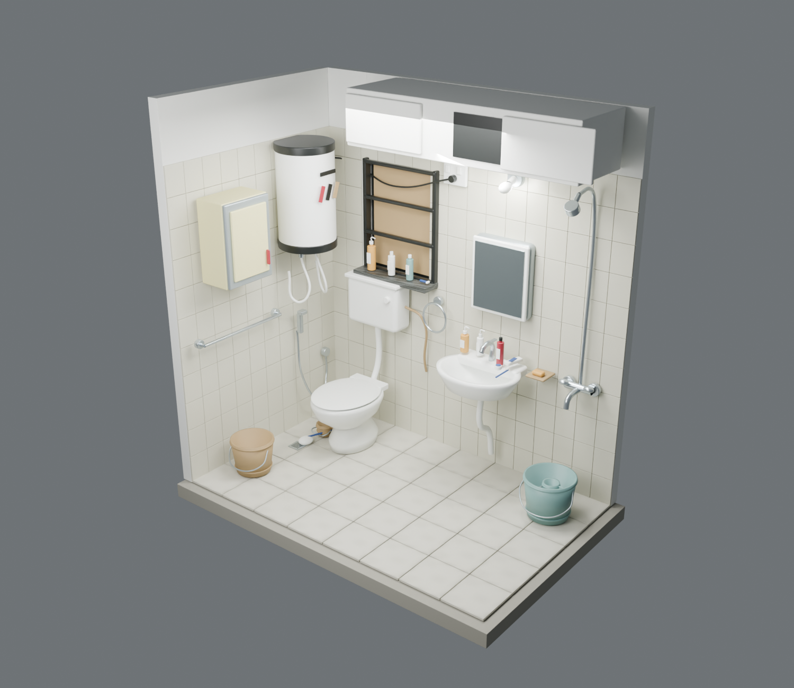

# Bathroom Rejigger

A small, personal bathroom design studio for Swati. Explore the current room, walk inside it, move or remove objects, try alternative fixtures and finishes, and save a proposed layout.

**[Open the design studio](https://sanjuhs.github.io/bathroom-rejigger/)** · [Project objective](OBJECTIVE.md) · [Reference interpretation](docs/REFERENCE_NOTES.md)



## What is here

- **16 original references:** 15 HEIC photographs and a 41-second MOV, preserved with SHA-256 checksums.
- **Blender master:** `blender/bathroom-existing.blend`, with 39 named groups covering the room shell, fixtures, fittings and small accessories.
- **Alternative fixture library:** seven authored concepts: toilet, floating oak vanity, rain shower, compact geyser, tall cabinet, rectangular basin and socket.
- **Browser editor:** orbit, overhead and first-person views; object selection; drag handles and numeric placement; rotation; 5 cm snapping; remove/restore; duplication; 60-step undo/redo; local autosave; JSON import/export; notes and PNG capture.
- **Finishes:** original surfaces plus limestone, sage ceramic, terrazzo and terracotta concepts for floor, tiled walls and shower feature wall.
- **Portable GLB exports:** also importable into Godot or another engine.

## For Swati

1. Open the studio on a laptop or desktop browser with WebGL.
2. Choose an object in the room or the list. Drag its handles, or enter its position in metres. Front/back is north-positive; height is floor-relative. Rotation turns around the vertical axis.
3. Remove an old fixture and use **Add something** to try a replacement. Accessories remain independent; select each item if a whole arrangement should move.
4. Try finishes in the right panel. Existing finishes are always recoverable.
5. **Walk inside** uses mouse look and WASD/arrow keys. Press Escape to return. **Top view** helps compare placements.
6. Write notes and choose **Save design**. Share the resulting JSON file; the other person chooses **Open design**. **Save image** captures the current 3D view.
7. **Reset to existing** restores the initial room. It can itself be undone.

Autosave belongs to the current browser/device, not a shared account. Export the JSON to keep or share it. There is no multiplayer synchronization. Touch devices support orbit and the layout controls; first-person walking is designed for a mouse and keyboard.

## Accuracy

This is an **interpretive reconstruction**, not a measured survey or photogrammetric scan. The user estimated **2.40 m length (±0.10 m) × 1.50 m width × approximately 2.60 m height**. The major layout and visible contents were reconstructed from the photos and video. Shapes, dimensions, material aging and small details are approximate; manufacturer labels and hidden geometry are simplified.

The floor is currently level. Drainage gradients, exact service routes, waterproofing, electrical specifications, door swing clearances and final installation dimensions must be checked on site. Browser overlap messages use bounding boxes and are only prompts to inspect a placement. Walk collision is a basic room/fixture approximation, not a building accessibility simulation. The mirror is an environment reflection, not a live reflection of every object.

## Run locally

Requires Node.js 22.12+ (or compatible recent version).

```sh
cd web
npm ci
npm run dev
```

Build with `npm run build`; run the design-file validation tests with `npm test`. A GitHub Actions workflow builds, tests and publishes the free GitHub Pages site.

## Rebuild the 3D assets

Use Blender 5.1 and Python with Pillow. Run from the repository root:

```sh
python3 scripts/make_textures.py
blender --background --factory-startup --threads 4 --python scripts/build_bathroom.py
```

On macOS, the Blender executable may be `/Applications/Blender.app/Contents/MacOS/Blender`. The script writes only within this project, builds in a separate process, and does not connect to or replace any existing interactive Blender session. It creates the master `.blend`, alternative `.blend`, complete GLB, seven fixture GLBs, three rendered views and the object inventory. The full room remains enclosed in the master; render cutaways temporarily hide selected walls only.

The source model uses Blender Z-up coordinates. GLB and the browser use Y-up; saved JSON positions are `[east, height, south]`. The generated root IDs provide the stable mapping between the browser and Blender. See `scripts/import_design.py` to turn a browser proposal into a separate Blender file.

## Repository contents and licensing

Original references are public in this repository at the owner's request. The project source, authored geometry, procedural textures and supplied references are distributed under MIT. Three.js, Vite and other dependencies retain their respective licenses. The interface loads optional Google Fonts and falls back to system sans-serif if unavailable.

[MIT license](LICENSE). No paid asset service or engine license is required.

To make a separate Blender proposal from a saved JSON design:

```sh
blender --background --factory-startup --python scripts/import_design.py -- my-design.json blender/my-proposal.blend
```

This transfers placement, rotation, visibility, copied/added fixtures and notes. Proposal finishes transfer as approximate solid colors; browser procedural patterns are not baked by this importer. The existing master is protected from overwrite.
